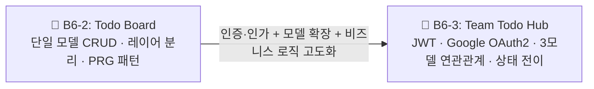

# 2026 Codyssey FastAPI — 단계별 백엔드 웹 서비스 구현

FastAPI, SQLAlchemy ORM, Jinja2 SSR을 활용해 **단일 모델 게시판형 웹 서비스(`b6-2`)**에서 **인증·인가·연관관계·상태 전이를 갖춘 팀 협업 서비스(`b6-3`)**로 단계적으로 확장한 백엔드 프로젝트 저장소입니다.

---

## 1. 미션 구성 및 발전 과정 (`B6-2` → `B6-3`)



| 구분 | B6-2 (`submissions/b6-2`) | B6-3 (`submissions/b6-3`) |
| :--- | :--- | :--- |
| **서비스 주제** | 개인 할 일 관리 (`Todo Board`) | 회원끼리 연결되는 팀 할 일 관리 (`Team Todo Hub`) |
| **데이터 모델** | 단일 모델 1개 (`Todo`) | 3개 모델 (`User` · `Project` · `Todo`), 1:N 양방향 연관관계 3쌍 |
| **인증 / 인가** | 없음 (공개) | JWT(`HttpOnly` 쿠키) + `Depends` 접근 제어 + 소유자 인가(403) |
| **소셜 로그인** | 없음 | Google OAuth2 Authorization Code Flow + `bcrypt` 회원가입 |
| **비즈니스 로직** | CRUD + 완료 토글 | 3단계 상태 전이(`대기 → 진행 중 → 완료`), 프로젝트 상태 전이 및 보관 제약 |
| **예외 처리** | 없는 데이터 개별 404 렌더링 | 전역 `@app.exception_handler` + 커스텀 예외(`401`/`403`/`404`/`400`) |
| **검색 / 필터** | 제목 `like` 검색 | 제목 · 상태 · 프로젝트 · 내 항목 다중 조건 동적 쿼리 |
| **상세 문서** | [B6-2 README 보기](./submissions/b6-2/README.md) | [B6-3 README 보기](./submissions/b6-3/README.md) |

---

## 2. 빠른 실행 (공용 `uv` + Python 3.13 환경)

루트의 `pyproject.toml`과 `uv.lock`을 `b6-2`, `b6-3`이 함께 공유하므로, 최초 1회만 의존성을 설치하면 두 프로젝트를 모두 바로 실행할 수 있습니다.

```bash
# 1. 공용 가상환경 생성 및 패키지 설치 (최초 1회)
uv sync
```

### B6-2 실행 (할 일 관리 웹 서비스)
```bash
uv run uvicorn main:app --app-dir submissions/b6-2 --reload --host 127.0.0.1 --port 8000
```

### B6-3 실행 (JWT + Google OAuth2 팀 할 일 관리)
```bash
uv run uvicorn main:app --app-dir submissions/b6-3 --reload --host 127.0.0.1 --port 8000
```
* 브라우저에서 `http://localhost:8000` 접속
* **B6-3 기본 테스트 계정**: `demo / demo1234`, `alice / alice1234` (최초 기동 시 자동 시딩)

---

## 3. 저장소 구조

```text
2026_codyssey_fastapi/
├── README.md                  # 전체 프로젝트 개요 및 핵심 개념 정리 (현재 파일)
├── pyproject.toml             # 루트 공용 uv 의존성 (Python 3.13)
├── uv.lock                    # 정확한 패키지 버전 잠금 파일
├── .gitignore                 # .venv, __pycache__, *.db, .env 제외
├── subjects/                  # 과제 명세 문서 (b6-2, b6-3)
└── submissions/
    ├── b6-2/                  # [미션 1] 단일 모델 CRUD + 레이어 분리 + PRG
    │   └── README.md
    └── b6-3/                  # [미션 2] JWT + Google OAuth2 + 3모델 연관관계 + 상태 전이
        └── README.md
```

---

## 4. 두 미션으로 정리하는 핵심 백엔드 개념

### 1) 레이어 분리 아키텍처 (`Router → Service → Repository → DB`)
* **Router (`routers/`)**: HTTP 요청(URL, Query, Form, Cookie)을 받아 응답(Jinja2 HTML 또는 Redirect)만 결정합니다.
* **Service (`services/`)**: 비즈니스 규칙(상태 전이 조건, 소유자 권한 검사, 입력 가공, DTO 변환)을 담당합니다.
* **Repository (`repositories/`)**: SQLAlchemy `Session`을 사용해 실제 DB 쿼리(`SELECT`/`INSERT`/`UPDATE`/`DELETE`)만 수행합니다.
* **이유**: 계층을 분리하면 화면(SSR ↔ JSON API)이나 DB(SQLite ↔ PostgreSQL)가 바뀌어도 다른 계층의 수정 범위를 최소화할 수 있습니다.

### 2) `GET` vs `POST`와 PRG (`Post-Redirect-Get`) 패턴
* **`GET`**은 상태를 바꾸지 않는 조회 요청, **`POST`**는 데이터를 생성·수정·삭제하는 상태 변경 요청에 사용합니다.
* `POST` 처리 직후 HTML을 바로 반환하면 새로고침(F5) 시 직전 `POST`가 재전송되어 **중복 등록/삭제**가 발생합니다.
* 이를 방지하기 위해 모든 `POST` 처리 후 `RedirectResponse(url=..., status_code=303)`를 반환해 브라우저가 안전한 `GET` 요청으로 화면을 다시 불러오도록 합니다.

### 3) `Form()` 입력 수신과 Pydantic 검증 / DTO 분리
* HTML `<form method="post">` 데이터는 `python-multipart`를 통해 FastAPI `Form(...)` 파라미터로 수신합니다.
* 수신한 값은 Pydantic 모델(`@field_validator`)에서 공백 제거·필수값·길이·형식을 검증하며, 실패 시 `HTTP 400`과 함께 기존 입력값을 유지한 채 오류 문구를 표시합니다.
* ORM 모델 대신 Pydantic DTO(`TodoResponse`)를 반환해 세션 종료 후 Lazy Loading 오류와 불필요한 필드 노출을 방지합니다.

### 4) FastAPI `Depends` 의존성 주입
* **DB 세션 관리 (`Depends(get_db)`)**: 요청 시작 시 `SessionLocal()`을 열고 `yield`로 주입한 뒤, 응답 종료 시 `finally: db.close()`로 세션을 안전하게 닫습니다.
* **인증 게이트 (`Depends(get_current_user)`)**: 보호 라우터의 파라미터에 선언하는 것만으로 비로그인 요청을 핸들러 진입 전에 일관되게 차단할 수 있습니다.

### 5) 인증(Authentication) vs 인가(Authorization)
* **인증 ("누구인가?")**: `auth/dependencies.py`에서 JWT를 검증해 현재 로그인한 `User`를 식별합니다. 미인증 시 `AuthRequiredException(401)` → `/login?next=...`로 리다이렉트합니다.
* **인가 ("권한이 있는가?")**: `services/`에서 로그인한 사용자가 해당 프로젝트의 `owner_id` 또는 할 일의 `author_id`인지 검증합니다. 권한이 없으면 `ForbiddenException(403)`을 발생시켜 전역 예외 핸들러가 차단 화면을 렌더링합니다.

### 6) JWT + `HttpOnly` 쿠키 & `bcrypt` 해싱
* 비밀번호는 평문으로 저장하지 않고 `bcrypt`로 솔트(Salt)가 포함된 단방향 해시로 저장합니다.
* 로그인 성공 시 `python-jose`로 HS256 JWT를 발급해 `HttpOnly`, `SameSite=Lax` 쿠키에 저장하므로, Jinja2 SSR 페이지 이동 시에도 자동으로 인증이 유지되면서 JS를 통한 토큰 탈취(XSS)를 방어합니다.

### 7) Google OAuth2 Authorization Code Flow
* `/auth/google/login`에서 랜덤 `state` 값을 쿠키에 저장하고 Google 동의 화면으로 리다이렉트합니다.
* `/auth/google/callback`에서 `state`를 대조(CSRF 방어)한 뒤, 인가 코드(`code`)를 Access Token으로 교환하고 사용자 프로필(이메일·이름)을 조회해 로컬 DB 회원과 연동한 뒤 동일한 JWT 쿠키를 발급합니다.

### 8) SQLAlchemy ORM 양방향 연관관계와 `cascade` 정책
* `User` 1:N `Project` 1:N `Todo` (및 `User` 1:N `Todo`) 구조를 `ForeignKey`와 양방향 `relationship(..., back_populates=...)`로 매핑해, 객체 탐색(`project.todos`, `user.projects`)만으로 연관 데이터를 조회합니다.
* 부모 삭제 시 고아 레코드를 남기지 않기 위해 `cascade="all, delete-orphan"`을 적용했으며, `joinedload`를 사용해 목록/상세 조회 시 N+1 쿼리 문제를 줄였습니다.
