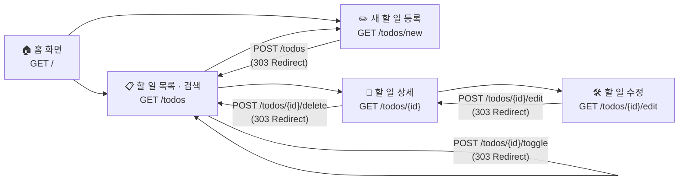
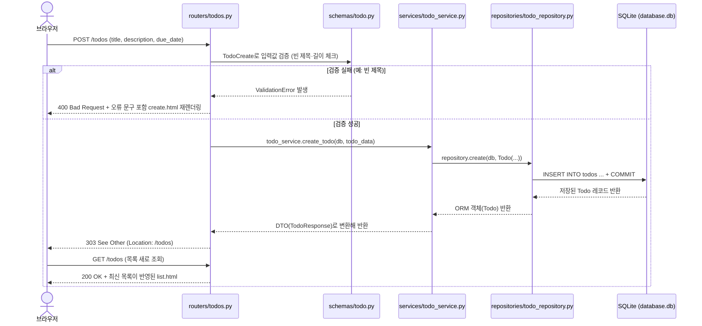

# Todo Board — FastAPI 기반 할 일 관리 웹 서비스 (B6-2)

> **처음 보는 분을 위한 한 줄 요약**
> 브라우저에서 할 일을 **등록 · 조회 · 검색 · 수정 · 완료 처리 · 삭제**할 수 있는 서버 사이드 렌더링(SSR) 웹 애플리케이션입니다.
> 단순히 동작하는 코드를 넘어, **브라우저 요청이 서버 내부 계층을 거쳐 SQLite 데이터베이스에 저장되고 다시 HTML 화면으로 돌아오는 전체 흐름**을 이해할 수 있도록 설계했습니다.

---

## 1. 이 프로젝트는 무엇을 하나요?

웹 브라우저(`http://localhost:8000`)에 접속하면 다음 5가지 핵심 화면을 통해 할 일을 관리할 수 있습니다.



* **홈 화면 (`/`)**: 서비스 소개, 전체/진행 중/완료 할 일 개수 요약, 목록 및 등록 화면 바로가기 링크 제공
* **할 일 목록 (`/todos`)**: 미완료 항목을 위쪽에, 최신 작성순으로 정렬해 표시하며 **제목 키워드 검색(`?q=`)**과 **원클릭 완료 상태 전환** 지원
* **할 일 상세 (`/todos/{id}`)**: 선택한 할 일의 모든 정보(ID, 제목, 완료 여부, 마감일, 작성일시, 상세 내용) 표시 + 수정/완료 토글/삭제/목록 이동 버튼 제공
* **등록 / 수정 폼 (`/todos/new`, `/todos/{id}/edit`)**: HTML Form으로 입력을 받아 서버에서 유효성을 검증하고, 빈 제목 등 오류가 있으면 입력값을 유지한 채 안내 문구 표시
* **예외 안내 (`404`)**: 존재하지 않거나 이미 삭제된 번호(`/todos/999` 등)에 접근하면 친절한 안내 화면(`not_found.html`) 표시

---

## 2. 빠른 시작 (실행 방법)

### 사전 요구사항
* Python `3.10` 이상 (본 프로젝트는 `uv` + **Python 3.13** 환경에서 개발 및 검증)
* 외부 패키지는 과제 제약사항인 **5종만 사용**합니다: `fastapi`, `uvicorn`, `sqlalchemy`, `jinja2`, `python-multipart`

### 방법 A. `uv` 환경으로 실행 (권장 — 워크스페이스 루트 공용 환경)

워크스페이스 루트(`2026_codyssey_fastapi/`)에서 아래 명령어를 순서대로 실행합니다.

```bash
# 1. 가상환경 생성 및 의존성 설치 (최초 1회)
uv sync

# 2. FastAPI 서버 실행
uv run uvicorn main:app --app-dir submissions/b6-2 --reload --host 127.0.0.1 --port 8000
```

> `submissions/b6-2/` 폴더 안에서 실행하려면 `cd submissions/b6-2 && uv run uvicorn main:app --reload`를 입력하면 됩니다.

### 방법 B. 표준 Python `venv`로 단독 실행

`submissions/b6-2/` 폴더만 따로 떼어내 실행할 때 사용합니다.

```bash
cd submissions/b6-2
python3 -m venv .venv
source .venv/bin/activate      # Windows: .venv\Scripts\activate
pip install -r requirements.txt
uvicorn main:app --reload
```

### 실행 확인
터미널에 아래와 같은 로그가 출력되면 정상 기동된 것입니다.
```text
INFO:     Uvicorn running on http://127.0.0.1:8000 (Press CTRL+C to quit)
INFO:     Application startup complete.
```
브라우저에서 `http://localhost:8000`에 접속해 서비스를 바로 사용해 볼 수 있습니다.

---

## 3. 프로젝트 구조와 레이어 분리 이해하기

이 프로젝트는 하나의 파일에 모든 코드를 몰아넣지 않고, **역할별로 폴더를 분리(Layered Architecture)**했습니다.

```text
submissions/b6-2/
├── main.py                     # 앱 진입점: FastAPI 생성, DB 테이블 초기화, 정적 파일 및 라우터 연결
├── database.py                 # DB 설정: SQLite 연결(database.db), SessionLocal, get_db() 의존성
├── requirements.txt            # 단독 실행용 패키지 목록
├── database.db                 # 서버 실행 시 자동 생성되는 SQLite 데이터베이스 파일
│
├── routers/                    # [1계층: 표현/요청] HTTP 요청 수신, 화면 렌더링 및 리다이렉트 결정
│   ├── __init__.py             # 공용 Jinja2Templates 설정
│   ├── home.py                 # GET /
│   └── todos.py                # /todos CRUD, 검색, 완료 토글 라우터
│
├── services/                   # [2계층: 비즈니스] 규칙 처리, 날짜 파싱, ORM 모델 ↔ DTO 변환
│   └── todo_service.py
│
├── repositories/               # [3계층: 데이터 접근] SQLAlchemy Session으로 실제 DB 쿼리 실행
│   └── todo_repository.py
│
├── models/                     # [DB 테이블 정의] SQLAlchemy ORM 모델 클래스
│   └── todo.py                 # Todo 테이블 (6개 컬럼)
│
├── schemas/                    # [입출력 데이터 검증] Pydantic DTO (ORM 모델 직접 반환 방지)
│   └── todo.py                 # TodoCreate, TodoUpdate, TodoResponse
│
├── templates/                  # [화면(View)] Jinja2 HTML 템플릿
│   ├── base.html               # 공통 상단 네비게이션 / 하단 푸터 레이아웃
│   ├── home.html               # 홈 화면
│   └── todos/
│       ├── list.html           # 할 일 목록 + 검색 + 원클릭 완료 토글
│       ├── detail.html         # 할 일 상세 (전체 필드 표시)
│       ├── create.html         # 새 할 일 등록 폼
│       ├── edit.html           # 할 일 수정 폼
│       └── not_found.html      # 404 안내 화면
│
└── static/
    └── style.css               # 외부 라이브러리 없이 작성한 자체 스타일시트
```

### 왜 이렇게 계층을 나눌까요?
* **라우터 (`routers/`)**는 "어떤 URL로 어떤 요청이 들어왔고, 어떤 화면을 보여줄지"에만 집중합니다.
* **서비스 (`services/`)**는 "입력값을 어떻게 가공하고, 어떤 순서로 처리할지(비즈니스 로직)"를 담당합니다.
* **저장소 (`repositories/`)**는 "DB에서 데이터를 어떻게 조회/저장/수정/삭제할지"만 담당합니다.

이렇게 나누면 나중에 **HTML 화면을 REST API(JSON)로 바꾸더라도 서비스와 저장소 코드는 그대로 재사용**할 수 있고, **SQLite를 PostgreSQL로 바꾸더라도 라우터 코드는 수정할 필요가 없습니다.**

---

## 4. 코드 흐름 따라가기 (예: "새 할 일 등록" 시 일어나는 일)

처음 코드를 읽을 때 아래 순서대로 파일을 열어보면 전체 동작 원리가 한눈에 들어옵니다.



---

## 5. 데이터 모델 및 URL 명세

### 단일 모델: `Todo` (`todos` 테이블)
| 컬럼명 | 타입 | 필수 여부 | 설명 |
| :--- | :--- | :---: | :--- |
| `id` | `Integer` | PK (자동 증가) | 할 일 고유 번호 |
| `title` | `String(100)` | 필수 (`NOT NULL`) | 할 일 제목 (공백 제외 1~100자) |
| `description` | `Text` | 선택 | 상세 메모 |
| `is_completed` | `Boolean` | 필수 (기본 `False`) | 완료 여부 (`진행 중` / `완료`) |
| `due_date` | `Date` | 선택 | 마감일 (`YYYY-MM-DD`) |
| `created_at` | `DateTime` | 필수 (자동 생성) | 최초 작성일시 |

### 전체 URL 목록
| HTTP Method | URL | 설명 | 성공 시 응답 |
| :--- | :--- | :--- | :--- |
| `GET` | `/` | 홈 화면 | `200` (`home.html`) |
| `GET` | `/todos` | 목록 조회 (`?q=검색어` 제목 검색 지원) | `200` (`todos/list.html`) |
| `GET` | `/todos/new` | 등록 폼 화면 | `200` (`todos/create.html`) |
| `POST` | `/todos` | 할 일 등록 처리 | `303 Redirect` → `/todos` |
| `GET` | `/todos/{todo_id}` | 단건 상세 조회 | `200` (`detail.html`) / `404` (`not_found.html`) |
| `GET` | `/todos/{todo_id}/edit` | 수정 폼 화면 | `200` (`edit.html`) / `404` (`not_found.html`) |
| `POST` | `/todos/{todo_id}/edit` | 할 일 수정 처리 | `303 Redirect` → `/todos/{todo_id}` |
| `POST` | `/todos/{todo_id}/toggle` | 완료 상태 즉시 전환 | `303 Redirect` → 이전 화면 |
| `POST` | `/todos/{todo_id}/delete` | 할 일 삭제 처리 | `303 Redirect` → `/todos` |

---

## 6. 꼭 알아야 할 핵심 웹 개념 5가지

1. **`GET`과 `POST`는 왜 구분해서 쓸까요?**
   * `GET`은 데이터를 **읽기(조회)**만 하므로 여러 번 요청하거나 새로고침해도 서버 데이터가 변하지 않습니다.
   * `POST`는 데이터를 **쓰기(생성/수정/삭제)** 위해 사용하며, HTML `<form method="post">`로 데이터를 요청 본문에 담아 안전하게 전달합니다.

2. **PRG (Post-Redirect-Get) 패턴과 `status_code=303`은 왜 필요할까요?**
   * `POST /todos` 처리 후 바로 HTML을 응답하면, 사용자가 브라우저에서 **새로고침(F5)**을 눌렀을 때 같은 `POST` 요청이 또 전송되어 **똑같은 할 일이 중복 등록**됩니다.
   * `RedirectResponse(url="/todos", status_code=303)`를 반환하면 브라우저가 `GET /todos`로 다시 요청을 보내므로, 이후 새로고침을 해도 안전한 목록 조회만 반복됩니다.

3. **HTML Form 입력값이 서버에서 어떻게 검증되나요?**
   * FastAPI가 `python-multipart`를 통해 `Form(...)` 파라미터로 폼 데이터를 받습니다.
   * 이를 `schemas/todo.py`의 Pydantic 모델(`TodoCreate`, `TodoUpdate`)에 넘기면 `@field_validator`가 공백 제거·빈 제목 차단·길이 제한을 검사합니다.
   * 브라우저 기본 검증에만 의존하지 않고 서버에서 직접 검증하므로(`novalidate` 적용), 빈 제목 제출 시 `HTTP 400` 상태와 함께 오류 메시지가 화면에 표시됩니다.

4. **SQLAlchemy ORM과 `Depends(get_db)`는 어떻게 동작하나요?**
   * `database.py`의 `get_db()`는 요청마다 `SessionLocal()`로 DB 세션을 열고 `yield`로 라우터에 주입한 뒤, 응답이 끝나면 `finally: db.close()`로 세션을 안전하게 닫습니다.
   * `TodoRepository`는 이 `Session`을 사용해 SQL을 직접 문자열로 쓰지 않고 파이썬 객체(`Todo`) 단위로 `query / add / commit / delete`를 수행합니다.

5. **ORM 모델 대신 Pydantic DTO(`TodoResponse`)를 반환하는 이유**
   * DB 세션이 닫힌 뒤 ORM 객체의 속성에 접근하다 발생하는 오류(Lazy Loading 문제)를 예방하고, 화면(템플릿)에 어떤 필드를 노출할지 명확히 통제하기 위해 서비스 계층에서 `TodoResponse.model_validate(todo)`로 변환합니다.

---

## 7. SQLite DB 저장 데이터 직접 확인하기

메모리(리스트/딕셔너리)가 아닌 실제 파일(`submissions/b6-2/database.db`)에 데이터가 저장되는지 아래 명령어로 직접 확인할 수 있습니다.

```bash
uv run python -c "
import sqlite3
conn = sqlite3.connect('submissions/b6-2/database.db')
for row in conn.execute('SELECT id, title, is_completed, due_date, created_at FROM todos'):
    print(row)
conn.close()
"
```

---

## 8. 과제 요구사항 체크리스트

- [x] **서버 실행**: Python 3.13 + `uv` 가상환경, 제약 패키지 5종만 사용, `http://localhost:8000` 동작
- [x] **프로젝트 구조**: `routers/`, `services/`, `repositories/`, `models/`, `schemas/`, `templates/`, `requirements.txt`
- [x] **SSR 렌더링**: 모든 주요 화면 Jinja2 `TemplateResponse` 사용
- [x] **홈 화면 (`GET /`)**: 앱 설명 + 목록/등록 링크 제공
- [x] **단일 모델 CRUD**: `Todo` 6개 필드, 목록/상세(전체 필드)/등록/수정/삭제 + 없는 ID `404` 안내 화면
- [x] **HTML Form + `POST` + `Form()`**: 입력 필드, 저장 버튼, 취소 링크 포함
- [x] **PRG 패턴**: 모든 상태 변경 `POST` 이후 `RedirectResponse(..., status_code=303)` 적용
- [x] **SQLite + SQLAlchemy + `Depends`**: 영구 파일(`database.db`) 저장 및 의존성 주입 세션 관리
- [x] **보너스 1 (검색)**: `GET /todos?q=...` + SQLAlchemy `filter(Todo.title.like(...))`
- [x] **보너스 2 (검증)**: Pydantic `@field_validator` 기반 서버 사이드 검증 및 오류 안내
- [x] **보너스 3 (UX 개선)**: 목록·상세 원클릭 완료 토글, 삭제 확인 창, 자연스러운 화면 전환

---

## 9. 향후 확장 가이드: 모델 간 연관관계 추가 및 마이그레이션 절차

> 본 미션(`b6-2`)은 제약 사항에 따라 **단일 모델(`Todo`) CRUD** 범위만 코드로 구현했습니다.
> 추후 `User(회원)` 또는 `Project(프로젝트)` 모델을 추가해 **1:N / N:1 연관관계**로 확장할 때 필요한 모델 변경 내용과 DB 마이그레이션 절차는 아래와 같습니다. (실제 확장 구현은 `submissions/b6-3/`에 반영되어 있습니다.)

### 1) 모델 변경: 필드 · `ForeignKey` · `relationship` 추가

예를 들어 `Project(1)` ↔ `Todo(N)` 양방향 연관관계를 추가할 때는 다음과 같이 모델을 정의합니다.

```python
# models/project.py (신규 부모 모델)
from sqlalchemy import Integer, String
from sqlalchemy.orm import Mapped, mapped_column, relationship
from database import Base

class Project(Base):
    __tablename__ = "projects"

    id: Mapped[int] = mapped_column(Integer, primary_key=True, autoincrement=True)
    name: Mapped[str] = mapped_column(String(100), nullable=False)

    # 1:N 양방향 연관관계 — 부모 삭제 시 자식 할 일도 함께 정리(cascade)
    todos: Mapped[list["Todo"]] = relationship(
        "Todo",
        back_populates="project",
        cascade="all, delete-orphan",
    )
```

```python
# models/todo.py (기존 자식 모델에 외래키 및 relationship 추가)
from sqlalchemy import ForeignKey, Integer
from sqlalchemy.orm import Mapped, mapped_column, relationship

class Todo(Base):
    __tablename__ = "todos"
    # ... 기존 필드 (id, title, description, is_completed, due_date, created_at) ...

    # 1. 외래키(ForeignKey) 컬럼 추가 (기존 데이터가 있다면 초기에는 nullable=True 권장)
    project_id: Mapped[int | None] = mapped_column(
        Integer,
        ForeignKey("projects.id"),
        nullable=True,
        index=True,
    )

    # 2. N:1 양방향 연관관계 매핑 (Project.todos와 back_populates로 연결)
    project: Mapped["Project | None"] = relationship(
        "Project",
        back_populates="todos",
    )
```

### 2) 데이터베이스 마이그레이션 절차

SQLAlchemy의 `Base.metadata.create_all(bind=engine)`은 **존재하지 않는 새 테이블만 생성**하며, 이미 생성된 `todos` 테이블에 새 컬럼(`project_id`)이나 `ForeignKey`를 자동으로 `ALTER TABLE` 해주지 않습니다. 따라서 아래 절차로 스키마를 안전하게 마이그레이션해야 합니다.

#### A. 로컬 개발(SQLite) 환경 — 기존 데이터 보존이 필요 없는 경우
1. 서버를 중지하고 기존 `database.db`를 백업(`cp database.db database.db.bak`)하거나 삭제합니다.
2. `main.py`에서 새 모델(`Project`)을 임포트해 `Base.metadata`에 등록합니다.
3. 서버를 다시 실행하면 `Base.metadata.create_all(bind=engine)`이 `projects` 테이블과 `project_id` 외래키가 포함된 `todos` 테이블을 새로 생성합니다.

#### B. 기존 데이터를 유지해야 하는 경우 — 단계적 마이그레이션 (Alembic 기준)
실무나 기존 데이터가 있는 DB에서는 **Alembic**을 사용해 무중단/단계적으로 스키마를 변경합니다.

1. **마이그레이션 환경 초기화**
   ```bash
   alembic init alembic
   ```
   * `alembic/env.py`에서 `target_metadata = Base.metadata`로 연결합니다.
   * **SQLite 주의사항**: SQLite는 `ALTER TABLE ... ADD CONSTRAINT FOREIGN KEY`를 직접 지원하지 않으므로, `alembic/env.py`의 `context.configure(...)`에 `render_as_batch=True` 옵션을 켜서 배치(임시 테이블 재생성) 모드로 마이그레이션합니다.
2. **마이그레이션 스크립트 생성 및 검토**
   ```bash
   alembic revision --autogenerate -m "add projects table and todo.project_id fk"
   ```
   * 생성된 리비전 파일에서 `projects` 테이블 생성, `todos.project_id` 컬럼 추가, `ForeignKey` 제약조건이 의도대로 작성되었는지 확인합니다.
3. **기존 데이터 백필(Backfill) 후 `NOT NULL` 전환**
   * 기존 `todos` 레코드가 있다면 ① `project_id`를 `nullable=True`로 먼저 추가 → ② 기본 프로젝트 레코드 생성 및 기존 `todos.project_id` 일괄 `UPDATE` → ③ 필요 시 `nullable=False`로 제약조건을 강화하는 2단계 마이그레이션을 수행합니다.
4. **마이그레이션 적용 및 롤백 검증**
   ```bash
   alembic upgrade head      # 최신 스키마 적용
   alembic downgrade -1      # 문제 발생 시 직전 버전으로 롤백
   ```

### 3) 계층별 코드 후속 수정 체크리스트
모델과 DB 스키마를 변경한 뒤에는 레이어 분리 구조에 따라 아래 순서로 코드를 업데이트합니다.
1. **`schemas/todo.py`**: `TodoCreate` / `TodoUpdate`에 `project_id` 필드 추가, `TodoResponse`에 프로젝트 요약 정보 포함
2. **`repositories/todo_repository.py`**: 목록/상세 조회 시 N+1 쿼리를 방지하기 위해 `joinedload(Todo.project)` 적용
3. **`services/todo_service.py`**: 할 일 생성·수정 시 대상 `project_id` 존재 여부 및 비즈니스 규칙 검증
4. **`routers/todos.py` & `templates/todos/*.html`**: 등록/수정 폼에 프로젝트 선택 `<select>` 추가 및 상세 화면에 소속 프로젝트 링크 출력
