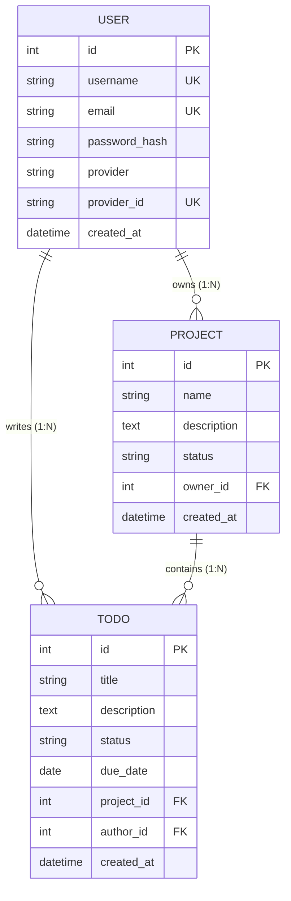

# Team Todo Hub — JWT 인증 · Google OAuth2 · 연관관계 기반 웹 서비스 (B6-3)

> **처음 보는 분을 위한 한 줄 요약**
> 이전 미션(`b6-2`)의 할 일 관리 서비스를 확장하여, **JWT 로그인/로그아웃, `Depends` 기반 접근 제어(인가), Google OAuth2 소셜 로그인, 3개 모델(`User` · `Project` · `Todo`) 양방향 연관관계, 상태 전이 비즈니스 로직**을 통합한 FastAPI 웹 서비스입니다.

---

## 1. 개발 환경 및 주요 패키지 버전

* **Python**: `3.13.5` (요구사항: 3.10 이상)
* **패키지 관리**: `uv` (워크스페이스 루트 공용 환경) 또는 `venv` + `requirements.txt`
* **주요 패키지 버전** *(과제 허용 범위 7종만 사용)*:
  | 패키지 | 버전 | 역할 |
  | :--- | :--- | :--- |
  | `fastapi` | `0.165.0` | 웹 프레임워크, `Depends` 인증/인가, 전역 예외 처리 |
  | `uvicorn` | `0.54.0` | ASGI 웹 서버 |
  | `sqlalchemy` | `2.1.9` | ORM 모델, 양방향 `relationship`, 동적 쿼리 |
  | `jinja2` | `3.1.6` | 서버 사이드 렌더링(SSR) HTML 템플릿 |
  | `python-multipart` | `0.0.34` | HTML Form 데이터 수신 (`Form(...)`) |
  | `python-jose` | `3.5.0` | HS256 JWT 액세스 토큰 발급 및 검증 |
  | `bcrypt` | `5.0.0` | 비밀번호 단방향 해싱 및 검증 |

> Google OAuth2 HTTP 통신 및 `.env` 로딩은 Python 표준 라이브러리(`urllib.request`, `secrets`, `os`)로 구현하여 허용 범위를 벗어나는 외부 라이브러리를 추가하지 않았습니다.

---

## 2. 실행 방법

### 방법 A. 루트 공용 `uv` 환경으로 실행 (권장)

워크스페이스 루트(`2026_codyssey_fastapi/`)에서 실행합니다.

```bash
# 1. 가상환경 생성 및 패키지 설치
uv sync

# 2. (선택) Google OAuth2 사용 시 .env 생성
cp submissions/b6-3/.env.example submissions/b6-3/.env

# 3. 서버 실행
uv run uvicorn main:app --app-dir submissions/b6-3 --reload --host 127.0.0.1 --port 8000
```

### 방법 B. 표준 Python `venv`로 단독 실행

```bash
cd submissions/b6-3
python3 -m venv .venv
source .venv/bin/activate      # Windows: .venv\Scripts\activate
pip install -r requirements.txt
uvicorn main:app --reload
```

서버 실행 후 브라우저에서 `http://localhost:8000`으로 접속합니다.

---

## 3. 테스트 계정 정보

최초 서버 기동 시 `seed.py`가 아래 **테스트 계정 2개**와 샘플 프로젝트·할 일을 `database.db`에 자동 생성합니다. (비밀번호는 `bcrypt`로 해싱되어 DB에 저장됩니다.)

| 아이디 (`username`) | 이메일 (`email`) | 비밀번호 | 용도 |
| :--- | :--- | :--- | :--- |
| `demo` | `demo@example.com` | `demo1234` | 기본 로그인 테스트 및 `alice` 프로젝트 수정 시도(403 인가 확인) |
| `alice` | `alice@example.com` | `alice1234` | 다른 회원 계정으로 로그인하여 회원 간 연관관계/권한 차이 확인 |

> `/signup` 페이지에서 새 계정을 직접 회원가입하거나, Google OAuth2로 소셜 로그인할 수도 있습니다.

---

## 4. 공개 / 보호 경로 정책 표

| 경로 패턴 | HTTP Method | 접근 정책 | 비로그인 시 동작 |
| :--- | :--- | :---: | :--- |
| `/` | `GET` | **공개** | 서비스 소개 + `[로그인]`, `[회원가입]` 버튼 표시 |
| `/login` | `GET`, `POST` | **공개** | 로그인 폼 표시 및 JWT 발급 |
| `/signup` | `GET`, `POST` | **공개** | 회원가입 폼 표시 및 `bcrypt` 해싱 저장 |
| `/auth/google/login`, `/auth/google/callback` | `GET` | **공개** | Google OAuth2 인증 흐름 수행 |
| `/static/**` | `GET` | **공개** | CSS 정적 리소스 제공 |
| `/logout` | `POST` | **보호 (로그인 필수)** | `AuthRequiredException` → `/login` 리다이렉트 |
| `/projects/**` | `GET`, `POST` | **보호 (로그인 필수)** | `AuthRequiredException` → `/login?next=/projects...` 리다이렉트 |
| `/todos/**` | `GET`, `POST` | **보호 (로그인 필수)** | `AuthRequiredException` → `/login?next=/todos...` 리다이렉트 |
| `/users/**` | `GET` | **보호 (로그인 필수)** | `AuthRequiredException` → `/login?next=/users...` 리다이렉트 |

### 소유자 기반 인가(Authorization) 정책
* 로그인한 회원은 **모든 회원의 프로젝트·할 일·프로필을 조회**할 수 있어 회원끼리 연결된 협업 구조를 확인할 수 있습니다.
* 단, 프로젝트 수정/상태 변경/삭제는 **프로젝트 소유자(`owner_id`)**만, 할 일 수정/삭제는 **작성자(`author_id`)**만 가능하며, 타인의 리소스에 접근하면 `ForbiddenException(403)`이 발생하여 전역 예외 핸들러가 일관된 안내 화면을 렌더링합니다.

---

## 5. 주요 기능 경로 목록

| 도메인 | Method | 경로 | 설명 |
| :--- | :--- | :--- | :--- |
| **홈 / 인증** | `GET` | `/` | 홈 화면 (로그인 여부에 따라 UI 분기) |
| | `GET`, `POST` | `/login` | 로그인 화면 및 JWT 쿠키 발급 |
| | `GET`, `POST` | `/signup` | 회원가입 (`bcrypt` 해싱) 및 자동 로그인 |
| | `POST` | `/logout` | JWT 쿠키 삭제 후 홈으로 리다이렉트 |
| | `GET` | `/auth/google/login` | Google OAuth2 동의 화면 이동 (`state` CSRF 쿠키 발급) |
| | `GET` | `/auth/google/callback` | Google 인가 코드 교환 → 회원 자동 연동 → JWT 발급 |
| **프로젝트** | `GET` | `/projects` | 프로젝트 목록 (이름 검색 `q`, 상태 `status`, 내 프로젝트 `mine`) |
| | `GET`, `POST` | `/projects/new`, `/projects` | 새 프로젝트 생성 |
| | `GET` | `/projects/{id}` | 프로젝트 상세 + 소유자 + 소속 할 일 목록(`1:N`) |
| | `GET`, `POST` | `/projects/{id}/edit` | 프로젝트 수정 (소유자 전용) |
| | `POST` | `/projects/{id}/status` | 프로젝트 상태 전이 (`진행 중` ↔ `완료` ↔ `보관`) |
| | `POST` | `/projects/{id}/delete` | 프로젝트 삭제 (소속 할 일 Cascade 삭제) |
| **할 일** | `GET` | `/todos` | 할 일 목록 (제목 `q`, 상태 `status`, 프로젝트 `project_id`, 내 할 일 `mine`) |
| | `GET`, `POST` | `/todos/new`, `/todos` | 새 할 일 등록 (소속 프로젝트 선택) |
| | `GET` | `/todos/{id}` | 할 일 상세 + 소속 프로젝트/작성자 링크 + 상태 전이 버튼 |
| | `GET`, `POST` | `/todos/{id}/edit` | 할 일 수정 (작성자 전용) |
| | `POST` | `/todos/{id}/status` | 할 일 상태 전이 (`대기` → `진행 중` → `완료`) |
| | `POST` | `/todos/{id}/delete` | 할 일 삭제 (작성자 전용) |
| **회원** | `GET` | `/users` | 가입 회원 목록 (가입 방식, 프로젝트/할 일 개수) |
| | `GET` | `/users/{id}` | 회원 상세 프로필 + 소유 프로젝트 목록 + 작성한 할 일 목록 |

---

## 6. 인증 방식 선택 사유 (JWT + `HttpOnly` 쿠키 + `Depends`)

이 프로젝트는 **JWT (JSON Web Token)** 기반 인증을 선택했습니다.

1. **확장성(Stateless)**: 서버 메모리에 세션 저장소를 두지 않고 서명된 토큰 자체로 사용자(`sub`, `username`, `exp`)를 검증하므로, 추후 모바일 앱이나 별도 프론트엔드(API 서버)로 확장하기 유리합니다.
2. **SSR 환경과의 자연스러운 통합 (`HttpOnly` 쿠키)**: Jinja2 템플릿 기반 웹에서는 브라우저가 링크 클릭(`GET`) 시 별도 JS 없이도 인증 정보를 함께 보내야 합니다. JWT를 `HttpOnly`, `SameSite=Lax` 쿠키(`access_token`)에 담아 전달함으로써 XSS 탈취 위험을 줄이면서 SSR 페이지 이동과 API(`Authorization: Bearer` 헤더) 모두를 지원합니다.
3. **`Depends`로 인증과 인가를 명확히 분리**:
   * `auth/dependencies.py`의 `get_optional_user`는 공개 페이지에서 로그인 여부만 확인합니다.
   * `get_current_user`는 보호 라우터에 주입되어 비로그인 요청을 진입 단계에서 즉시 차단(`AuthRequiredException`)하고 `/login?next=...`로 보냅니다.
   * 이후 서비스 계층(`services/`)에서 소유자 일치 여부(인가)를 검증하여 `ForbiddenException(403)`을 발생시킵니다.

---

## 7. 도메인 모델 및 연관관계 설계



* **양방향 연관관계 (`relationship` + `back_populates`) 3쌍**:
  * `User.projects` ↔ `Project.owner`
  * `User.todos` ↔ `Todo.author`
  * `Project.todos` ↔ `Todo.project`
* **부모 삭제 시 자식 처리 정책 (`cascade="all, delete-orphan"`)**:
  * `Project` 삭제 시 하위 `Todo`는 소속 프로젝트 없이 독립 존재할 수 없는 종속 데이터이므로 고아 레코드를 방지하기 위해 `cascade="all, delete-orphan"`을 적용했습니다. (각 모델 파일 코드 주석에도 동일 정책을 명시했습니다.)
* **상태 변경 중심 비즈니스 로직**:
  * **할 일 상태 전이**: `todo(대기)` → `in_progress(진행 중)` → `done(완료)` (상세/프로젝트 화면에서 즉시 전이 및 배지 반영)
  * **프로젝트 상태 전이**: `active(진행 중)` → `completed(완료)` / `archived(보관)` — `archived` 상태의 프로젝트에는 새 할 일을 추가할 수 없도록 서비스 계층에서 차단합니다.

---

## 8. Google OAuth2 소셜 로그인 설정 가이드 (보너스 3)

1. [Google Cloud Console](https://console.cloud.google.com/) → **API 및 서비스 → 사용자 인증 정보**에서 OAuth 2.0 클라이언트 ID(웹 애플리케이션)를 생성합니다.
2. **승인된 리디렉션 URI**에 아래 주소를 추가합니다.
   * 로컬: `http://localhost:8000/auth/google/callback`
   * 배포 시: `https://<배포도메인>/auth/google/callback`
3. `submissions/b6-3/.env.example`을 `.env`로 복사한 뒤 발급받은 키를 입력합니다.
   ```env
   JWT_SECRET_KEY=your-long-random-secret-key
   GOOGLE_CLIENT_ID=your-google-client-id.apps.googleusercontent.com
   GOOGLE_CLIENT_SECRET=your-google-client-secret
   GOOGLE_REDIRECT_URI=http://localhost:8000/auth/google/callback
   ```
4. 서버를 재시작하고 `/login` 화면의 **Google 계정으로 계속하기** 버튼을 클릭하면, 최초 로그인 시 회원이 자동 생성되고 JWT 쿠키가 발급됩니다.

---

## 9. 외부 배포 가이드 — Render (보너스 5)

`submissions/b6-3/render.yaml`이 포함되어 있어 Render에서 바로 배포할 수 있습니다.

1. [Render Dashboard](https://dashboard.render.com/)에서 **New + → Blueprint** 또는 **Web Service**를 선택하고 이 GitHub 저장소를 연결합니다.
2. 설정 확인:
   * **Root Directory**: `submissions/b6-3`
   * **Build Command**: `pip install -r requirements.txt`
   * **Start Command**: `uvicorn main:app --host 0.0.0.0 --port $PORT`
3. **Environment Variables** 설정:
   * `PYTHON_VERSION`: `3.13.5`
   * `JWT_SECRET_KEY`: 랜덤 시크릿 문자열
   * `COOKIE_SECURE`: `true`
   * *(Google 로그인 사용 시)* `GOOGLE_CLIENT_ID`, `GOOGLE_CLIENT_SECRET`, `GOOGLE_REDIRECT_URI`

---

## 10. 프로젝트 구조

```text
submissions/b6-3/
├── main.py              # FastAPI 앱, lifespan(DB 초기화+시딩), 전역 예외 핸들러, 라우터 등록
├── config.py            # 표준 라이브러리 기반 .env 환경변수 로더
├── database.py          # SQLite 연결, SessionLocal, Base, get_db()
├── exceptions.py        # AppException, AuthRequiredException, ForbiddenException, NotFoundException
├── seed.py              # 테스트 계정(demo, alice) 및 샘플 프로젝트/할 일 시딩
├── render.yaml          # Render 배포 Blueprint 설정
├── .env.example         # 환경변수 템플릿
├── requirements.txt     # 단독 실행 및 배포용 패키지 목록
├── auth/                # security.py(JWT/bcrypt), dependencies.py(Depends), google_oauth.py
├── models/              # user.py, project.py, todo.py (3개 ORM 모델 + 양방향 연관관계)
├── schemas/             # auth.py, project.py, todo.py (Pydantic 검증)
├── repositories/        # user_repository.py, project_repository.py, todo_repository.py
├── services/            # auth_service.py, project_service.py, todo_service.py
├── routers/             # home.py, auth.py, projects.py, todos.py, users.py
├── templates/           # base.html, home.html, error.html, auth/*, projects/*, todos/*, users/*
└── static/style.css     # 자체 반응형 CSS
```

---

## 11. 과제 요구사항 및 보너스 체크리스트

- [x] **인증 (`auth/`, `Depends`, JWT)**: 로그인/로그아웃, 성공·실패 피드백, 테스트 계정 명시
- [x] **접근 제어(인가)**: 공개/보호 경로 분리, 비로그인 차단(`/login` 이동), 소유자 외 수정/삭제 `403` 차단
- [x] **인증 상태별 UI**: 로그인 전 `[로그인]/[회원가입]` ↔ 로그인 후 `"OOO님 환영합니다" + [로그아웃]`
- [x] **3개 모델 + 양방향 연관관계**: `User` / `Project` / `Todo`, 1:N 관계 3개, `back_populates`, `cascade` 정책 주석 명시
- [x] **상태 변경 비즈니스 로직**: 할 일(`대기 → 진행 중 → 완료`), 프로젝트(`진행 중 → 완료/보관`)
- [x] **보너스 1 (전역 예외 처리)**: `@app.exception_handler` + 커스텀 예외(`401`/`403`/`404`/`400`)
- [x] **보너스 2 (검색 / 필터)**: 프로젝트·할 일 동적 SQLAlchemy 필터 쿼리
- [x] **보너스 3 (Google OAuth2)**: Authorization Code Flow + `state` 검증 + 회원 자동 연동
- [x] **보너스 4 (회원가입 & 해싱)**: `/signup` + `bcrypt` 비밀번호 해싱
- [x] **보너스 5 (외부 배포 준비)**: `render.yaml` 및 Render 배포 가이드 포함
